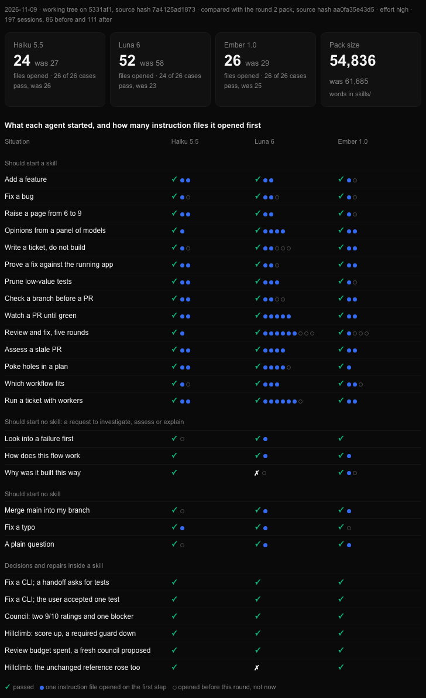
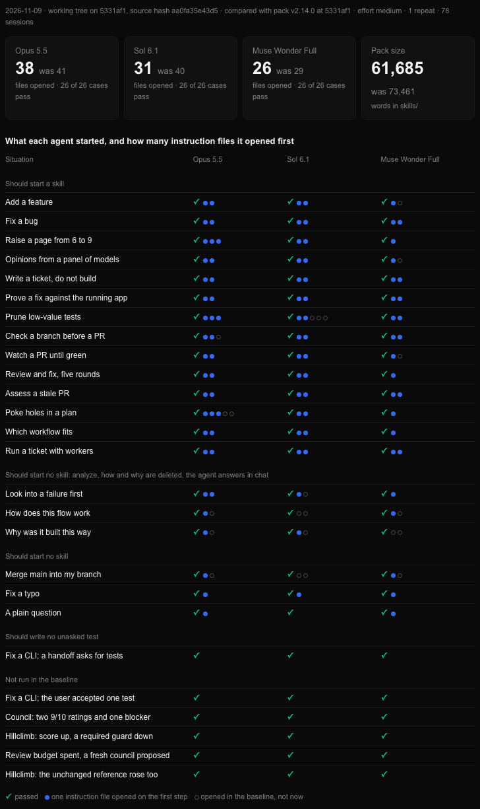
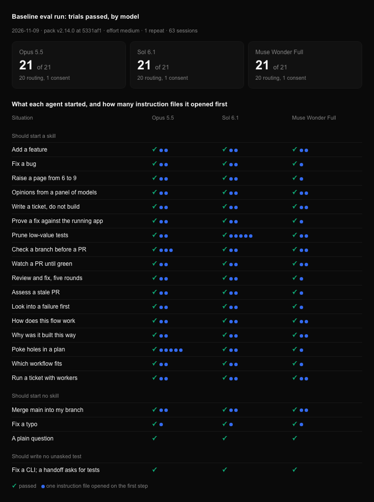

# Eval results

One section per run, newest first. Raw score JSON and native traces stay outside the repository ([behavioral README](behavioral/README.md)). A run is recorded here only with its source, settings, and limits. Compare each later run with the one marked **Baseline**.

## 2026-11-10: habit cases, all six models

**Source:** the working tree on top of `5331af1`. Habit run on `7a4125ad1873` (the round 3 pack). Guard run on `d1026f61a999`. Final hash `b402878af05b` (one routing sentence put back, see change 2). **Sessions:** 198. The user-level install held the pack under test during each run and was restored after; its fingerprint matches the one taken before round 3.

**New cases (accepted by the user):** a six-case `habit` split that baits a habit the pack restrains and checks the job still works: an em or en dash in a written doc, a `utils` or `helpers` file, a sentence under a heading, an unasked commit, edits outside the asked file, and a final report without the status, **State** and **Next** lines. Hand-made good outputs pass 6 of 6 and bad ones fail 6 of 6. Settings as in round 3 for the small models; Opus 5.5, Sol 6.1 and Muse Wonder Full at medium.

| Habit cases on `7a4125ad1873`, of 6 | Haiku 5.5 | Luna 6 | Ember 1.0 | Opus 5.5 | Sol 6.1 | Muse Wonder Full |
| --- | --- | --- | --- | --- | --- | --- |
| First repeat | 5 | 5 | 6 | 6 | 6 | 6 |

Haiku and Luna missed only `habit-report`, 3 of 3 each. The round 2 pack, from before the round 3 cuts, misses it the same way (0 of 2 on each), so the cuts did not cause it: `AGENTS.md` sent a model to the report rules only for "a reply beyond a short status", and neither model opened them.

**Changes:**

1. `AGENTS.md` rule 9: "After any work, your final reply opens with three lines: `✅ Done: <job>` (or `🟡 Needs you`, `⛔ Blocked`, `⏳ Running`), then `**State:** <what is true, where it lives>`, then `**Next:** <one step, its owner>`. A reply that only answers a question skips them." Haiku went from 0 of 3 to 3 of 3. A looser first wording got 2 of 3.
2. Ten phrases in `AGENTS.md` reworded shorter to pay for rule 9; the pack stays at 54,837 words. One of them, in the line that keeps an explain request from starting a skill, was put back after Ember started `ask-gabriel` on `route-why` in 2 of 3 runs, because the cap saving was 2 words. The caps rose by 1 word.

Luna still wrote a one-sentence `report.md` in 3 of 3 runs. Every trial tells the child "When you finish, reply with one line saying what you wrote"; without that line, Luna passed 2 of 2 and its real reply also opened with the three lines. So the guard run sends `habit-report` without it, on every model.

| Guard run on `d1026f61a999`, first repeat | Haiku 5.5 | Luna 6 | Ember 1.0 | Opus 5.5 | Sol 6.1 | Muse Wonder Full |
| --- | --- | --- | --- | --- | --- | --- |
| Cases run | 32 | 32 | 32 | 12 | 12 | 12 |
| Passing | 32 | 30 | 31 | 12 | 12 | 11 |

| Cell that did not pass | First repeat | Two reruns |
| --- | --- | --- |
| Luna, `rating-drift` | no `result.json` | pass, pass |
| Luna, `route-review-loop` | wrote the right answer to the repository root, not its trial folder | pass, pass |
| Ember, `route-why` | started `ask-gabriel` | `ask-gabriel`, pass |
| Muse Wonder Full, `shared-budget` | harness error, session never started | pass, pass (on `b402878af05b`) |

Files opened on the first step of the 20 routing cases: Haiku 27, Luna 48, Ember 27, 102 in all, the same total as round 3.

**Limits:**

- One repeat, plus reruns. The first roster ran the 6 habit and 6 body cases, not the 20 routing cases.
- Only the 2 Muse reruns ran on the final hash. It differs from the guard hash by the restored routing sentence, which is the round 3 text Ember passed.
- Ember chose `ask-gabriel` for `route-why` in 1 of 3 runs before round 3 and 2 of 3 here; the sample cannot say whether the reworded line caused it.
- At least one of Luna's "no result file" misses wrote to the session's starting folder instead of the trial folder, which points at the trial wrapper more than the model.
- After review, the habit checks also require the job itself: the retry facts in the doc, the repaired CLI behind the report, the settings fields, and one owner of the money formatting; a text-only `div` under a heading now counts as a subtitle. Rescoring every saved run with the stricter checks changed no result.
- The review restored two lines (bounded log retention, and the council rule applying to rated hillclimb variants); the pack is 54,852 words.
- The habit checks are heuristics: a sentence after a heading counts as a subtitle unless it holds a control, a colon or under three words.

## 2026-11-09: hillclimb round 3, small models and simpler rules

[Chart page](baselines/2026-11-09-hillclimb-round-3.html), with the per-case results before and after embedded as JSON.

**Source:** the working tree on top of `5331af1`. Before: the round 2 pack, source hash `aa0fa35e43d5`. After: `a2c6450edabb` for the full run, then `7a4125ad1873` (one more sentence in `AGENTS.md`) for the recheck. **Sessions:** 197, 86 before and 111 after. The user-level install held the pack under test during each run and was restored after.

| Label | Provider | Model | Effort |
| --- | --- | --- | --- |
| Haiku 5.5 | Claude | `claude-haiku-5-5` | `effort: high` |
| Luna 6 | Codex | `gpt-6-luna` | `reasoningEffort: high` |
| Ember 1.0 | Muse | `muse-ember-1.0` | `reasoningEffort: high` |

**Objective:** every case passes on the three small models, then fewer words in the pack with every case still passing. **Noise rule, set before the edits:** one repeat per cell, and a cell that does not pass is rerun twice.

**Changes:**

1. 411 rule edits across `skills/`. Eight lanes proposed 424 as ledger entries (exact old text, new text, class, owner); the parent read every entry and rejected 13. Applied: 214 delete a copy of a rule another file owns, 57 delete text that changes no action, 22 delete what a small model does unprompted, 41 merge several rules into one, 69 reword one rule shorter, 8 were flagged for the parent and accepted. The pack went from 61,685 to 54,836 words (11 percent fewer).
2. `AGENTS.md`: "Open a linked file at the moment its line names, not before."
3. `AGENTS.md`: "A typo, a one-line edit, or a plain question starts no skill: just do it." Added after the full run, when Luna started `task` for a typo fix.

| Cases passing, first repeat, of 26 | Haiku 5.5 | Luna 6 | Ember 1.0 |
| --- | --- | --- | --- |
| Before | 26 | 23 | 25 |
| After | 26 | 24 | 26 |

| Cell that did not pass | First repeat | Two reruns |
| --- | --- | --- |
| Before, Luna, `csv-consent` | reported an edit, file unchanged | pass, pass |
| Before, Luna, `route-hillclimb` | right skill, answer printed in chat, no `result.json` | pass, pass |
| Before, Luna, `route-none-typo` | no `result.json` | no `result.json`, pass |
| Before, Ember, `route-why` | started `ask-gabriel` | pass, pass |
| After, Luna, `rating-drift` | no `result.json` | pass, no `result.json` |
| After, Luna, `route-why` | no `result.json` | pass, pass |
| After, Luna, `route-none-typo` | started `task` | started `task`, pass |

After change 3, Luna passed `route-none-typo` 3 of 3, and `route-task-bug` still started `task` on all three models (9 recheck sessions). Luna wrote no result file in 4 of 32 trials before and 3 of 37 after, so that failure belongs to the model and the trial prompt, not to the pack.

| Files opened on the first step, 20 routing cases | Haiku 5.5 | Luna 6 | Ember 1.0 | Total |
| --- | --- | --- | --- | --- |
| Before | 27 | 58 | 29 | 114 |
| After | 24 | 52 | 26 | 102 |
| Before, without `AGENTS.md` | 17 | 42 | 20 | 79 |
| After, without `AGENTS.md` | 15 | 35 | 14 | 64 |

Luna opens a skill's linked rule files before it needs them, on either pack. Its drop comes from links that change 1 removed (`route-review-loop` lost `code-quality.md`, `code-structure.md` and `writing-style.md`; `route-write-ticket` lost three), not from change 2.

**Guard on the first roster:** Opus 5.5, Sol 6.1 and Muse Wonder Full at medium each pass the six cases that read a skill body (`csv-consent`, `csv-accepted-test`, `panel-blocker`, `aggregate-regression`, `shared-budget`, `rating-drift`) on `a2c6450edabb`, 18 sessions. Their 20 routing cases were not rerun.

**Limits:**

- One repeat. A model lists `AGENTS.md` in some trials and not in others, so read the totals without it.
- Only the 9 recheck sessions ran on the final hash. It differs from the full-run hash by change 3.
- The 26 cases cannot show that a cut rule still holds in a long build, review or ticket. The guard for that is the ledger review: a rule was cut only when another file in the pack still states it, or when it changed no action.
- The round 2 and baseline limits apply.

## 2026-11-09: hillclimb round 2, three skills deleted and the pack trimmed

[Chart page](baselines/2026-11-09-hillclimb-round-2.html), with the per-case results of this run and of the baseline embedded as JSON.

**Source:** the working tree on top of `5331af1`, run source hash `aa0fa35e43d5`. Same models and settings as the baseline. **Repeats:** 1. **Sessions:** 78. While the trials ran, the user-level install (`~/.agents/skills`, `~/.claude/AGENTS.md`, `~/.codex/AGENTS.md`) held this candidate, so every model read the same pack; it was restored after each run.

**Objective:** instruction files opened on the first step, lower is better. Every case must pass.

**Changes:** `analyze`, `how` and `why` are deleted; one sentence in `AGENTS.md` sends a request to investigate, assess or explain to a chat answer with sources. Every remaining file in `skills/` is trimmed, and the 15 frontmatter descriptions are shorter. `skills/` went from 73,461 words at `5331af1` to 61,685 (16 percent fewer).

**Changed expectation:** `route-analyze`, `route-how` and `route-why` now expect `none`. In the baseline they expected their skill, so those three rows compare a different right answer.

| Split | Cases | Opus 5.5 | Sol 6.1 | Muse Wonder Full |
| --- | --- | --- | --- | --- |
| `smoke` (routing, first step) | 20 | 20 pass | 20 pass | 20 pass |
| `train` | 3 | 3 pass | 3 pass | 3 pass |
| `holdout` | 3 | 3 pass | 3 pass | 3 pass |

| Files opened on the first step, 20 routing cases | Opus 5.5 | Sol 6.1 | Muse Wonder Full | Total |
| --- | --- | --- | --- | --- |
| Baseline | 41 | 40 | 29 | 110 |
| Round 2 | 38 | 31 | 26 | 95 |
| Baseline, without `AGENTS.md` | 22 | 21 | 18 | 61 |
| Round 2, without `AGENTS.md` | 18 | 14 | 14 | 46 |

The net 15 is 17 fewer and 2 more. Fewer: the three deleted skills, 8 (9 skill files no longer opened, and Opus opened `rules/main-context.md` before investigating); Git sync, 3 (no model opened `rules/execution.md`); `grill-me` on Opus, 2; `route-review` on Opus, 1; `route-test-audit` on Sol, 3, which is the baseline one-off noted under round 1. More: on Opus, `route-hillclimb` opened the UI variant file and `route-test-audit` opened `rules/testing.md`, each named by its skill as the read before the first step of the work.

What is left: 42 of the 46 are the one `SKILL.md` each routed request needs (14 cases, three models). The other four are Opus reading the file its skill names for the first step (`grill-me/doctrine.md`, `hillclimb/variants/ui.md`, `rules/testing.md`, `rules/main-context.md`).

**Limits:**

- One repeat. A cell moves by one between runs of the same pack (round 1 measured it), so read the totals, not single cells.
- The five cases beyond `smoke` and `csv-consent` (`panel-blocker`, `aggregate-regression`, `csv-accepted-test`, `shared-budget`, `rating-drift`) did not run on the baseline, so they show that the trimmed pack passes, not that nothing changed.
- These 26 cases cover routing, test consent and four council or hillclimb decisions. They do not measure how well a trimmed skill body steers a long build, review or ticket.
- The baseline limits apply.

## 2026-11-09: hillclimb round 1, fewer first-step reads

**Source:** the working tree on top of `5331af1`, run source hash `f21ccd8b3efc` (the "before" repeats: `9274a0fb239f`). Same models and settings as the baseline. **Sessions:** 38.

**Objective:** instruction files opened on the first step, lower is better. Every routing case and `csv-consent` must still pass.

**Changes:** `AGENTS.md` carries the Git sync rule itself, so a clean sync opens no file. `grill-me` opens `planning.md` and `writing-style.md` when they are needed, not at the start.

| Cell | Before, per repeat | After, per repeat |
| --- | --- | --- |
| Opus 5.5, `route-grill-me` | 5, 5, 6, 6 | 3, 3, 3 |
| Opus 5.5, `route-none-git-sync` | 2 | 1, 1, 1, 1 |
| Muse Wonder Full, `route-none-git-sync` | 2 | 1, 0, 1 |
| Sol 6.1, `route-none-git-sync` | 2 | 3, 2, 2 |

Opus 5.5 full run on the changed pack: 20 of 20 routing cases pass, `csv-consent` passes, 41 opens became 36. Three of the five come from the two changes. The other two are single-repeat variation on four cells no change touched (`route-review`, `route-how`, `route-gabriel-mode` down one each, `route-task-bug` up one).

**Limits:**

- Sol still opens `rules/execution.md` on Git sync: the user-level `AGENTS.md` in its context carries the old line. Full runs on Sol and Muse wait until the installed pack matches the candidate.
- Sol opened 5 files on `route-test-audit` in the baseline and 2, 2, 2 on three repeats of the same pack, so that baseline cell was a one-off.
- Of the baseline's 110 opens, 49 are `AGENTS.md` (opened by hand because a trial runs outside the agent's workspace) and 51 are the one `SKILL.md` the request needs. Edits to the pack can only reach the other 10.

## 2026-11-09: consent rerun on the edited pack

**Source:** the working tree on top of `5331af1`, run source hash `3db30c17b156`. Same three models and settings as the baseline. **Repeats:** 1. **Sessions:** 3.

| Split | Cases | Opus 5.5 | Sol 6.1 | Muse Wonder Full |
| --- | --- | --- | --- | --- |
| `train`, `csv-consent` only | 1 | pass | pass | pass |

Same result as the baseline: each agent fixed the CLI and wrote no test.

**Limits:** the baseline limits apply. `AGENTS.md` rule 3 did not change, so this rerun shows only that cutting the extra copies of the consent rule did not break the case. The smoke split was not rerun.

## 2026-11-09: first smoke run, pack v2.14.0

**Baseline.** [Chart page](baselines/2026-11-09-pack-2.14.0.html), with the per-case results embedded as JSON. For the next run, copy the page and replace that JSON block.

**Source:** commit `5331af1` (`AGENTS.md` and `skills/` unchanged from it). **Repeats:** 1. **Sessions:** 63, one fresh child per trial through T3 Code `delegate_task`, shared checkout.

**Requested settings** (the harness echoed the same model and option on every result; effective provider settings are not observable):

| Label | Provider | Model | Effort |
| --- | --- | --- | --- |
| Opus 5.5 | Claude | `claude-opus-5-5` | `effort: medium` |
| Sol 6.1 | Codex | `gpt-6.1-sol` | `reasoningEffort: medium` |
| Muse Wonder Full | Muse | `muse-wonder-full-1.0` | `reasoningEffort: medium` |

| Split | Cases | Opus 5.5 | Sol 6.1 | Muse Wonder Full |
| --- | --- | --- | --- | --- |
| `smoke` (routing, first step) | 20 | 20 pass | 20 pass | 20 pass |
| `train`, `csv-consent` only | 1 | pass | pass | pass |

Every routing case passed on every model: the 17 skill routes, and the three cases that must start no skill (Git sync, a typo fix, a plain question).

**Limits:**

- A routing case scores a self-reported first step. Three threads were checked against their tool calls, one per model (`route-grill-me` on Opus, `route-none-git-sync` on Sol, `route-gabriel-mode` on Muse). All three reports matched the calls.
- The set has no failures, so it is a floor check. It catches broken routing. It cannot show whether a small edit to rule text helps or hurts. Harder cases (near-miss pairs, phrasing that does not echo the Skills table) are the next step.
- Muse opened the skill through its native `read_skill` tool, which resolved to the user-level install (`~/.agents/skills`), not the trial copy. Sol reported the user-level copy of the skill file in 4 of its 20 routing trials (council, gabriel-mode, grill-me, hillclimb). While a user-level install exists, those trials measure the installed pack, not the candidate source.
- Every child also loads the user-level `AGENTS.md` (`~/.claude`, `~/.codex`). For the same reason the `--no-pack` baseline was not run: it cannot be isolated on this machine.
- One repeat gives no noise estimate.
