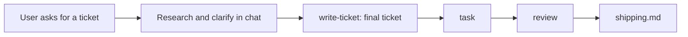

# Journey: a new Feature on a strong foundation

**The user says:** "We need to take payments at checkout. Write a ticket for it."
**Next journey:** [add a provider that fits the seam](follow-up-fits-the-seam.md).



## 1. Route

Open `write-ticket/SKILL.md`.

## 2. Understand the intent

1. Investigate first: checkout has no payment step, the team already has a Stripe account, and two customers asked for PayPal in support threads.
2. Restate the goal in plain English: customers pay for their own order at checkout, and a retry never charges twice. `/grill-me` settles the material choices. A Feature's choices include the areas of modularity ([strong-foundation.md](../strong-foundation.md#find-the-areas-of-modularity)):

```markdown
## Questions
Reply like: 1a 2a

1. Will there be more than one payment provider?
   - a) yes: Stripe now, PayPal asked for by two customers ← recommended
   - b) no: Stripe only
2. Will checkout charge in more than one currency?
   - a) no: CAD only for the next year ← recommended
   - b) yes
```

3. The user answers `1a 2a`. Record the decisions:

```markdown
## Kind
Feature

## Areas of modularity
- Payment provider: yes, Stripe now, PayPal requested by two customers
- Currency: no, CAD only for the next year
```

## 3. Write the final ticket

The grill settles the remaining implementation decision and its rival:

- Chosen: a `billing` service with a `PaymentProvider` seam, Stripe as the one real implementation.
- Rejected: Stripe calls inside the checkout feature. PayPal would then mean editing every caller.

The grill also yields rules that must stay true: Rule 1, a retry with the same key never charges twice. Rule 2, only the order's owner can pay for it ([Authority](../code-structure.md#authority)).

```markdown
## Foundation
- Payment provider → `PaymentProvider` adapter, registry in `services/billing/`. Ships with Stripe only
- Currency → no seam (settled: CAD only)
- Next change this makes small: adding PayPal is one adapter file plus one registry entry
```

Follow the [ticket contract](../../write-ticket/reference.md#plan).

## 4. Build

The user says "build IN-42": open `task/SKILL.md`.

1. **Grill.** The ticket settled the foundation, so no new areas question. The Locked in message names the public entry: `billing.makeUserPay`.
2. **Plan and slices.** Slice 1 builds the service and the seam. Slice 2 wires checkout to `makeUserPay`. Before each slice, open [keep-it-simple.md](../keep-it-simple.md): one registry object, no provider factory, no currency seam.
3. **Tests.** After verifying, `/verification` lists "Tests worth keeping": 1. end to end, a customer pays once; 2. integration, `makeUserPay` denies a caller who does not own the order. The user replies `tests 1 2` and `/verification` writes both.

```text
services/billing/
  billing.ts            # public: makeUserPay, refundPayment
  payment-provider.ts   # seam: the PaymentProvider interface
  providers.ts          # registry: { stripe: stripeProvider }
  stripe-provider.ts    # first real implementation
features/checkout/
  use-checkout.ts       # calls billing.makeUserPay
```

## 5. Review and ship

`/review` runs nested on the branch diff. The Foundation check passes: the provider area has a seam with one implementation, and currency has none because the user settled CAD only. The tests the user named are green.

[Verification scope](../execution.md#verification-scope) follows checkout through billing and the provider, including ownership and retry behavior.

When the user replies `ship` to the [ship offer](../../task/reference.md#ship-offer), open [shipping.md](../shipping.md): branch `feature/IN-42-add-checkout-payments`, then the full PR title and body for approval before creating it.

## If a step is skipped

- No preparation grill: Stripe gets hardcoded at every caller.
- A seam on currency anyway: a keep it simple (KISS) finding at review.
